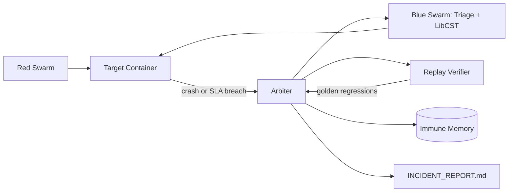

# OmniResilience · Phase 4

[](https://github.com/potlasrisharan/ominirush-Immune/actions/workflows/ci.yml)
[](https://www.python.org/downloads/release/python-3120/)
[](https://www.docker.com/)
[](https://github.com/potlasrisharan/ominirush-Immune/actions/workflows/ci.yml)

OmniResilience is a deterministic closed-loop resilience demo. The Red Swarm
breaks a deliberately vulnerable FastAPI target, the Blue Swarm triages the
failure and applies a LibCST patch, and the Arbiter replays the exact
`AttackDNA` before it commits the patch to Immune Memory.

## Quickstart

Requirements: Python 3.12.8 (pinned in `.python-version`) and Docker Engine
with Compose v2.

```bash
python3.12 -m venv .venv
.venv/bin/python -m pip install -r requirements.lock

# Full sandbox demo: upstream → target → Arbiter
docker compose up --build

# Offline unit and integration suite
make test
# equivalent: .venv/bin/pytest -v tests/
```

For a local-only run, the Arbiter starts and stops Uvicorn subprocesses itself:

```bash
.venv/bin/python main.py --mode local --fresh --no-ui
.venv/bin/python main.py --mode local --no-ui --json
```

To inspect the live mission-control dashboard in a browser without starting the
chaos loop, run the standalone dashboard server (default port `8080`) and open
`http://127.0.0.1:8080/dashboard`:

```bash
.venv/bin/python main.py --serve-dashboard
# or choose a port
.venv/bin/python main.py --serve-dashboard 9090
```

The run writes `INCIDENT_REPORT.md`, DNA under `artifacts/dna/`, patch files
under `artifacts/patches/`, and cached signatures under `artifacts/memory/`.
Runtime artifacts are ignored by git.

Immune-memory entries are HMAC-SHA256 signed over their signature ID, patch
strategy, base-file SHA-256, and modified source. Set `OMNI_SIGNING_KEY` to a
random secret in production; local demos use the built-in development fallback.
The latest summary is also written to `artifacts/dashboard_state.json`, which
the dashboard server loads when it starts.

## Architecture

```text
┌───────────────┐   AttackDNA   ┌──────────────┐   failure   ┌─────────────┐
│ Red Swarm     │ ─────────────▶ │ Target API   │ ─────────▶ │ Arbiter     │
│ Fuzz/Storm/   │                │ FastAPI      │             │ triage      │
│ Latency       │ ◀───────────── │ + Upstream   │ ◀────────── │ patch/restart│
└───────────────┘    replay     └──────────────┘   proof     └──────┬──────┘
                                                                    │
                                                   ┌────────────────▼───────┐
                                                   │ Immune Memory + Report  │
                                                   └─────────────────────────┘
```



## Four phases

1. **Baseline:** `/health`, `/api/v1/catalog`, and `/api/v1/status` establish a
   clean target before chaos begins.
2. **Break it:** FuzzNet triggers the order panic, StormLoad stresses the
   serialized inventory lock, and LatencyDrift triggers the uncapped upstream
   request.
3. **Heal it:** TriageEngine identifies the failure signature and PatchLadder
   tries the smallest CST transformer first, rolling back on failed proof.
4. **Prove it:** the target is restarted, the exact DNA is replayed, and the
   golden endpoints are checked again. Verified patches are stored in Immune
   Memory and included in the incident report. Passing repairs then continue
   through the adversarial escalation round and Git audit persistence described
   below.

Run 1 heals all three bugs. Run 2 sees the same signatures and loads the
verified patches immediately, which is shown as a `MEMORY_HIT` / vaccinated
count in the HUD and JSON summary.

## Adversarial Escalation Round

After the exact triggering `AttackDNA` passes baseline verification and golden
regression, the `EscalationEngine` runs a deterministic mutation-testing round
to check generalized immunity. Each incident receives exactly three bounded
mutations with independently regenerated DNA identities:

- JSON order requests exercise a numeric boundary, a Unicode/injection-shaped
  value, and nested type confusion.
- Inventory stress requests vary concurrency and request count within fixed
  limits.
- Query-driven requests vary the relevant `delay` parameter, including a
  bounded malformed value.

Every mutation must complete within the execution budget, leave the target
healthy, and return an accepted success or validation response. A controlled
HTTP 504 from the payment timeout guard is accepted as containment. The Arbiter
keeps baseline verification and generalized-immunity certification distinct:
`escalation_passed` is only set after all mutations survive. Lifecycle events
(`escalation_started`, `escalation_passed`, and `escalation_failed`) appear in
the event timeline, HUD state, and generated `INCIDENT_REPORT.md`.

## Auto-Branching Git Engine

Every verified repair is persisted as an auditable, isolated Git branch named
`heal/<sanitized_sig_id>`, for example `heal/sig-order-panic-01`. The
`GitBranchEngine`:

1. Validates the repository, active symbolic branch, target path, tracked-file
   status, and verification gate.
2. Builds a commit from the original `HEAD` plus only the patched target file
   using a temporary Git index. Unrelated staged, unstaged, and untracked work
   is preserved.
3. Creates the branch without checking it out, so the original branch and
   `HEAD` remain active and unchanged. The patched target file is restored on
   the original worktree after the branch commit is saved.
4. Refuses detached or conflicted repositories, invalid paths, failed or
   incomplete verification, existing repair branches, and unsafe branch names.

The audit commit records the signature ID, triggering DNA ID and SHA-256,
original branch, base commit, target file, patch strategy, pre-heal error rate,
post-heal survival rate, p99 latency, baseline verification, escalation status,
golden regression, and `OmniImmune Engine` attribution. The terminal HUD shows
the actual branch and short commit SHA. The incident report records `CREATED`,
`FAILED`, or `NOT_ATTEMPTED` accurately; a Git persistence failure never gets
reported as a successful commit.

## CLI

```text
--mode docker|local   Runtime placement (default: docker)
--seed INTEGER        Deterministic chaos seed (default: 1337)
--fresh               Clear cached immune signatures before running
--no-ui               Stream no HUD output; useful in CI
--json                Emit the final ImmunitySummary as JSON
--serve-dashboard [PORT]
                      Serve the browser dashboard without running chaos
                      (default port when supplied without a value: 8080)
```

## Docker notes

The Compose demo uses three services on the `omni_net` network. The Arbiter
mounts `/var/run/docker.sock` so Docker mode can restart the target after a
patch; it also mounts the target source so the CST edit is visible to the
target container. This is intentionally a local demonstration sandbox and
requires a Docker daemon available to Compose.

## Checks and reproducibility

- Runtime and all Python packages are pinned (`.python-version` and
  `requirements.lock`).
- `make test` is the single offline test command.
- CI runs `pytest -v tests/` followed by
  `docker compose up --build --exit-code-from omniimmune`.
- No secrets are required; `.env.example` documents optional environment
  overrides.

## Assumptions

- The bundled vulnerable target is the Phase 1–3 target and is the source file
  patched by the demo.
- Local mode may use ports 8000 and 9000 unless `TARGET_URL` and `UPSTREAM_URL`
  point at other local services.
- A handled `504` from the explicit upstream timeout boundary counts as a
  contained, surviving incident.
- Compose Docker mode uses the conventional container name
  `omniimmune-target`, overridable with `OMNI_TARGET_CONTAINER`.
