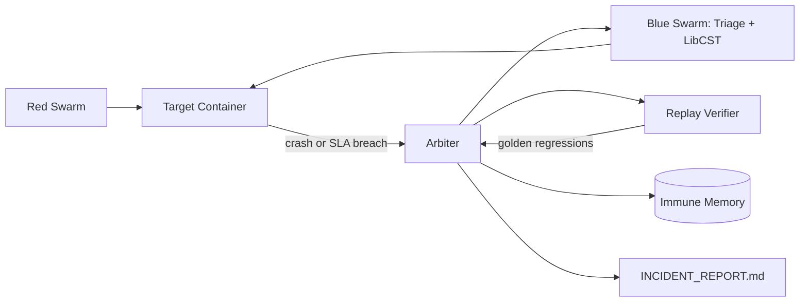

# OmniResilience · Phase 4

OmniResilience is a deterministic closed-loop resilience demo. The Red Swarm
breaks a deliberately vulnerable FastAPI target, the Blue Swarm triages the
failure and applies a LibCST patch, and the Arbiter replays the exact
`AttackDNA` before it commits the patch to Immune Memory.

## Quickstart

Requirements: Python 3.12.8 (pinned in `.python-version`) and Docker Engine
with Compose v2.

```bash
python3.12 -m venv .venv
.venv/bin/python -m pip install -r requirements.lock

# Full sandbox demo: upstream → target → Arbiter
docker compose up --build

# Offline unit and integration suite
make test
# equivalent: .venv/bin/pytest -v tests/
```

For a local-only run, the Arbiter starts and stops Uvicorn subprocesses itself:

```bash
.venv/bin/python main.py --mode local --fresh --no-ui
.venv/bin/python main.py --mode local --no-ui --json
```

The run writes `INCIDENT_REPORT.md`, DNA under `artifacts/dna/`, patch files
under `artifacts/patches/`, and cached signatures under `artifacts/memory/`.
Runtime artifacts are ignored by git.

## Architecture

```text
┌───────────────┐   AttackDNA   ┌──────────────┐   failure   ┌─────────────┐
│ Red Swarm     │ ─────────────▶ │ Target API   │ ─────────▶ │ Arbiter     │
│ Fuzz/Storm/   │                │ FastAPI      │             │ triage      │
│ Latency       │ ◀───────────── │ + Upstream   │ ◀────────── │ patch/restart│
└───────────────┘    replay     └──────────────┘   proof     └──────┬──────┘
                                                                    │
                                                   ┌────────────────▼───────┐
                                                   │ Immune Memory + Report  │
                                                   └─────────────────────────┘
```



## Four phases

1. **Baseline:** `/health`, `/api/v1/catalog`, and `/api/v1/status` establish a
   clean target before chaos begins.
2. **Break it:** FuzzNet triggers the order panic, StormLoad stresses the
   serialized inventory lock, and LatencyDrift triggers the uncapped upstream
   request.
3. **Heal it:** TriageEngine identifies the failure signature and PatchLadder
   tries the smallest CST transformer first, rolling back on failed proof.
4. **Prove it:** the target is restarted, the exact DNA is replayed, and the
   golden endpoints are checked again. Verified patches are stored in Immune
   Memory and included in the incident report.

Run 1 heals all three bugs. Run 2 sees the same signatures and loads the
verified patches immediately, which is shown as a `MEMORY_HIT` / vaccinated
count in the HUD and JSON summary.

## CLI

```text
--mode docker|local   Runtime placement (default: docker)
--seed INTEGER        Deterministic chaos seed (default: 1337)
--fresh               Clear cached immune signatures before running
--no-ui               Stream no HUD output; useful in CI
--json                Emit the final ImmunitySummary as JSON
```

## Docker notes

The Compose demo uses three services on the `omni_net` network. The Arbiter
mounts `/var/run/docker.sock` so Docker mode can restart the target after a
patch; it also mounts the target source so the CST edit is visible to the
target container. This is intentionally a local demonstration sandbox and
requires a Docker daemon available to Compose.

## Checks and reproducibility

- Runtime and all Python packages are pinned (`.python-version` and
  `requirements.lock`).
- `make test` is the single offline test command.
- CI runs `pytest -v tests/` followed by
  `docker compose up --build --exit-code-from omniimmune`.
- No secrets are required; `.env.example` documents optional environment
  overrides.

## Assumptions

- The bundled vulnerable target is the Phase 1–3 target and is the source file
  patched by the demo.
- Local mode may use ports 8000 and 9000 unless `TARGET_URL` and `UPSTREAM_URL`
  point at other local services.
- A handled `504` from the explicit upstream timeout boundary counts as a
  contained, surviving incident.
- Compose Docker mode uses the conventional container name
  `omniimmune-target`, overridable with `OMNI_TARGET_CONTAINER`.
