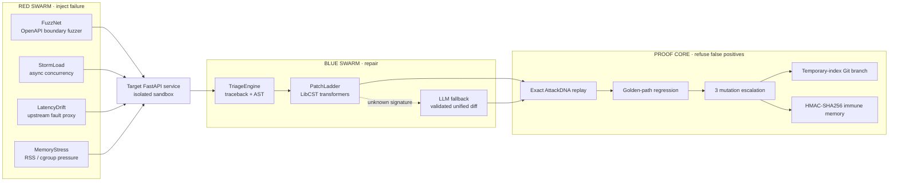

# OmniImmune / OmniResilience

## Break it. Heal it. Prove it.

**A deterministic, closed-loop chaos engineering and autonomous program-repair platform for APIs that must survive hostile input, concurrency pressure, upstream failure, and resource exhaustion.**

[](https://github.com/potlasrisharan/ominirush-Immune/actions/workflows/ci.yml)
[](https://www.python.org/downloads/release/python-3128/)
[](https://docs.docker.com/compose/)
[](https://github.com/potlasrisharan/ominirush-Immune/actions/workflows/ci.yml)
[](INCIDENT_REPORT.md)
[](#architecture)
[](LICENSE)

> **Systems / Infrastructure / Cybersecurity** — OmniImmune turns an incident into a signed, replay-verified, adversarially escalated repair. It does not stop at “the test passed.” It produces evidence that the repaired service survives the original attack, its golden paths, and three deterministic mutations.

```text
┌─ OMNIIMMUNE MISSION CONTROL v1.0.0 ─────────────────────────────────────────┐
│ [RED SWARM]  FuzzNet ➔ /api/v1/order [CRASH: 500 Unhandled Panic]             │
│ [BLUE SWARM] TriageEngine ➔ culprit: target_app/app.py:37 (ValueError)      │
│ [LIBCST]     PatchLadder: strategy[0] applied (InputGuardTransformer)       │
│ [PROOF]      Replay verified (HTTP 400 Handled) · Escalation: 3/3 SURVIVED  │
│ [STATUS]     VACCINATED ➔ heal/sig-6303d35c7823 (commit: 28f0406)           │
└─────────────────────────────────────────────────────────────────────────────┘
```

## Why this is different

Most chaos tools stop at detection. Most repair tools stop at compilation. OmniImmune closes the loop:

```text
OpenAPI AST → schema-aware attack → isolated failure → traceback/AST triage
     → LibCST semantic patch → exact AttackDNA replay → golden regression
     → 3-round adversarial escalation → isolated Git commit → HMAC-signed memory
```

The implementation is intentionally concrete:

- **LibCST**, not regex replacement, preserves formatting and comments while applying semantic transforms.
- **OpenAPI AST traversal** discovers the target contract and synthesizes boundary payloads instead of guessing endpoints.
- **HMAC-SHA256** authenticates cached repair source, signature, strategy, and base-file digest.
- **Temporary Git index manipulation** creates `heal/<sig_id>` without staging, dirtying, or rewriting the operator’s active worktree.
- **Nearest-rank percentiles** make latency decisions deterministic and auditable across runs.
- **AttackDNA** captures the exact request, headers, timing, seed, and failure signature required for replay.

## Architecture



### Runtime boundaries

| Boundary | Primitive | Failure it contains |
| --- | --- | --- |
| Attack | `FuzzNet`, `StormLoad`, `LatencyDrift`, `MemoryStressAgent` | malformed input, event-loop starvation, upstream timeout, unbounded allocation |
| Triage | traceback parsing + AST inspection | host-path leakage and imprecise root-cause attribution |
| Repair | LibCST `PatchLadder` | syntactically valid but semantically unsafe text edits |
| Verification | exact replay + golden paths + mutation escalation | overfitted patches and collateral regressions |
| Persistence | temporary Git index + signed memory | contaminated operator state and cache poisoning |
| Operations | SSE, Rich HUD, HTML, Prometheus | opaque execution and unauditable outcomes |

## The four-phase closed loop

### 1. Baseline verification

The Arbiter checks `/health`, `/api/v1/catalog`, and `/api/v1/status`, recording response schemas and clean latency boundaries before it attacks.

### 2. Coordinated chaos waves — **break it**

- **FuzzNet** reads `GET /openapi.json`, traverses the schema, and synthesizes boundary numbers, `null`, Unicode, and type-confusion payloads for `/api/v1/order`.
- **StormLoad** sends asynchronous bursts to `/api/v1/inventory/reserve`; blocking locks and `time.sleep` reveal event-loop starvation when p99 exceeds the SLA.
- **LatencyDrift** injects packet loss and latency into `/api/v1/payment/verify`; uncapped HTTP clients are expected to fail with a controlled `504` after repair.
- **MemoryStressAgent** exercises `/api/v1/cache/item` and observes RSS/container pressure caused by unbounded accumulation.

Every incident becomes an `AttackDNA` record: SHA-256 identity, endpoint, payload, headers, timing, seed, and failure signature.

### 3. AST triage and semantic repair — **heal it**

`TriageEngine` parses stderr and traceback frames, then inspects AST structure to identify the culprit file, function, and line without exposing machine-specific paths. `PatchLadder` applies the smallest matching LibCST transform:

| Signature | Deterministic repair |
| --- | --- |
| Panic / `ValueError` | Validate the request boundary and return structured `400 Bad Request` JSON. |
| Starvation | Replace blocking locks/sleeps with `asyncio.Lock` and `await asyncio.sleep`. |
| Timeout | Add a 1.5-second boundary and catch `httpx.TimeoutException` as `504 Gateway Timeout`. |
| Resource exhaustion | Replace unbounded list accumulation with `deque(maxlen=1000)`. |

Unknown signatures can use the optional LLM fallback. The generated unified diff is still parsed, applied, compiled, and sent through the same proof gates.

### 4. Verification, escalation, and Git audit — **prove it**

1. Restart the target worker/container.
2. Replay the exact failing `AttackDNA` and require a controlled status code.
3. Run golden-path regression checks.
4. Generate three deterministic mutations: numeric boundaries, Unicode injection, and type confusion.
5. Require `3/3` survival before vaccination.
6. Commit to `heal/<sig_id>` with a temporary Git index, leaving the current branch and worktree untouched.
7. Persist the verified repair with HMAC-SHA256 provenance.

## Quickstart

### Prerequisites

- Python **3.12.8**, pinned in `.python-version`.
- Docker Engine with Docker Compose **v2** for the containerized path.
- Git. The local path runs offline after the locked dependencies are installed.

### Install from a clean checkout

```bash
git clone https://github.com/potlasrisharan/ominirush-Immune.git
cd omnirush-Immune

python3.12 -m venv .venv
source .venv/bin/activate
python -m pip install --requirement requirements.lock
cp .env.example .env  # optional; never commit secrets
```

### Run the isolated Docker mission

This starts the upstream mock, vulnerable target, and Arbiter on a private Compose network:

```bash
docker compose up --build
```

### Run the offline local mission

```bash
make demo
# equivalent:
.venv/bin/python main.py --mode local --fresh
```

For CI-friendly output:

```bash
.venv/bin/python main.py --mode local --fresh --no-ui --json
```

### Launch Mission Control

```bash
make dashboard
# http://127.0.0.1:8080/dashboard
```

## Track Alignment: Systems, Infrastructure & Cybersecurity

OmniImmune is designed for the **Systems, Infrastructure & Cybersecurity** track because it treats resilience as a controlled systems problem: attack the service, repair the implementation, and refuse to declare success until the repair survives independent proof.

- **Autonomous self-healing:** The Red Swarm generates deterministic failures from real API contracts, while the Blue Swarm triages traceback and AST evidence and selects a minimal LibCST repair. The Arbiter restarts the target, replays the exact incident, checks golden paths, and escalates through three mutations without requiring an operator to hand-edit the service.
- **Zero-trust memory:** Verified repairs are stored as immune memory only after HMAC-SHA256 authentication over the incident signature, patch strategy, base-file digest, and modified source. Tampered or stale cache entries are rejected and routed back through clean triage rather than executed as trusted code.
- **AST patch verification:** LibCST transformations operate on Python syntax trees instead of fragile text substitutions, preserving source structure and formatting. Every patch is compiled, replay-verified, regression-tested, adversarially escalated, and committed through an isolated temporary Git index with provenance.

This creates a verifiable infrastructure control loop: **chaos signal → semantic repair → cryptographic memory → repeatable proof**.

## CLI reference

```text
Usage: main.py [OPTIONS]

--version                 Show engine version and exit.
--mode [docker|local]     Select the Docker sandbox or local subprocesses.
--seed INTEGER            Deterministic chaos seed; default: 1337.
--fresh                   Clear cached immune memory and heal branches.
--no-ui                   Disable the Rich HUD for automation.
--json                    Emit ImmunitySummary as JSON.
--push-pr                 Push verified heal branches and create PRs via gh.
--serve-dashboard [PORT]  Serve the dashboard; default port: 8080.
```

## Evidence and outputs

Every run is designed to leave inspectable evidence under `artifacts/`:

```text
artifacts/
├── memory/<sig_id>.json       # HMAC-authenticated repair record
├── report.html                # standalone interactive report
├── metrics.prom               # Prometheus exposition
└── prs/<sig_id>.md            # reproduction-ready PR body
INCIDENT_REPORT.md              # Markdown incident timeline and verdict
```

The HMAC covers `(sig_id, strategy, base_file_sha256, modified_source)`. Tampering raises `UntrustedImmuneMemoryError`; the engine rejects the cache and returns to clean triage.

## Testing and verification

The canonical offline command is:

```bash
make test
```

The 92-test suite covers:

- OpenAPI schema traversal and deterministic payload synthesis.
- Fuzz, concurrency storm, latency proxy, and memory-pressure agents.
- LibCST transforms, syntax preservation, and docstring retention.
- Exact replay, golden regression, and adversarial escalation.
- Temporary Git index isolation, branch sanitization, and provenance.
- HMAC tamper rejection and immune-memory cache hits.
- SSE fan-out, dashboard behavior, CLI validation, and end-to-end Arbiter flows.

## Project map

```text
.
├── main.py                  # single CLI entrypoint
├── omniimmune/
│   ├── arbiter.py           # Red → Blue → Proof supervisor
│   ├── models.py            # AttackDNA, latency, and domain schemas
│   ├── events.py            # sync/async event bus
│   ├── memory.py            # zero-trust HMAC-SHA256 memory
│   ├── report.py            # Markdown, HTML, Prometheus, and PR reports
│   ├── chaos/               # FuzzNet, StormLoad, LatencyDrift, MemoryStress
│   ├── healer/              # triage, LibCST patching, isolated Git branches
│   ├── verifier/            # replay and escalation gates
│   └── ui/                  # Rich HUD and FastAPI dashboard
├── target_app/              # intentionally vulnerable FastAPI service
├── upstream/                # configurable upstream mock
├── blueprints/              # agent blueprints
├── tests/                   # unit, integration, and end-to-end verification
├── docker-compose.yml       # three-service sandbox
├── Dockerfile               # pinned Python runtime image
├── requirements.lock        # reproducible dependency set
├── Makefile                 # test, demo, dashboard, and cleanup commands
└── .github/workflows/ci.yml # pytest + Compose smoke test
```

## Configuration and security posture

Copy `.env.example` for local configuration. `OMNI_SIGNING_KEY` is optional for the deterministic demo but should be set to a deployment secret outside the sandbox. Do not put API keys in source, reports, or commits. The optional LLM fallback reads `OPENAI_API_KEY`, `GEMINI_API_KEY`, or `OMNI_LLM_KEY` from the environment.

The target service is intentionally vulnerable. Run it only in the supplied isolated sandbox or a disposable local environment. The system’s security boundary is the combination of container isolation, deterministic attack identity, cryptographic memory verification, and proof-gated Git output.

## License

Apache License 2.0. See [LICENSE](LICENSE).

## Contributing

Keep changes reproducible: use Python 3.12.8, install from `requirements.lock`, run `make test`, and include tests for behavior changes. Pull requests should explain the failure signature, repair strategy, replay result, escalation verdict, and any new evidence artifacts.
