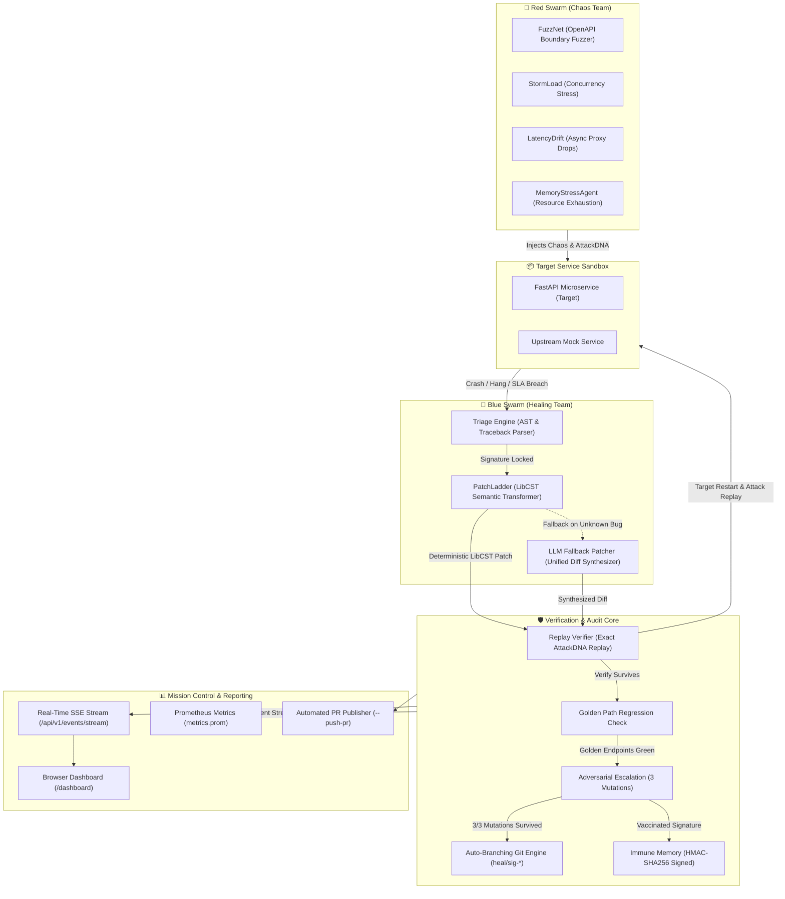

# OmniImmune (OmniResilience)

> **Autonomous Chaos Engineering & Self-Healing Agent Swarm**  
> *"Break it. Heal it. Prove it."*

[](https://github.com/potlasrisharan/ominirush-Immune/actions/workflows/ci.yml)
[](https://www.python.org/downloads/release/python-3120/)
[](https://www.docker.com/)
[](https://github.com/potlasrisharan/ominirush-Immune/actions/workflows/ci.yml)
[](INCIDENT_REPORT.md)
[](LICENSE)

OmniImmune is a deterministic, closed-loop resilience engineering platform that bridges the gap between **Chaos Engineering (Red Team)** and **Automated Program Repair (Blue Team)** inside an isolated sandbox. 

The Red Swarm launches coordinated multi-vector chaos against a target service until it crashes or breaches SLA limits. The Blue Swarm ingests the failure, pinpoints the root cause via AST and stack trace triage, applies minimal syntax-preserving code repairs via Concrete Syntax Trees (LibCST) or an autonomous LLM fallback, proves the fix through replay verification and adversarial escalation, and commits the hardened code to an isolated Git branch and cryptographically signed Immune Memory.

---

## 🏗️ Architecture



---

## ⚡ The 4-Phase Closed Loop

1. **Phase 1: Baseline Verification**
   - The engine validates golden endpoints (`/health`, `/api/v1/catalog`, `/api/v1/status`) to establish baseline health, response schemas, and clean latency boundaries.
2. **Phase 2: Coordinated Chaos Waves (Break It)**
   - **FuzzNet** (`AttackType.FUZZ`): Discovers endpoints via `GET /openapi.json` and synthesizes schema-aware payloads (boundary numbers, Unicode, nulls) targeting `/api/v1/order` to trigger unhandled `ValueError` or `ZeroDivisionError` panics.
   - **StormLoad** (`AttackType.STORM`): Floods `/api/v1/inventory/reserve` with asynchronous request bursts, exposing blocking `threading.Lock` and `time.sleep` calls that starve the event loop (p99 latency > 1,500ms).
   - **LatencyDrift** (`AttackType.LATENCY`): Emulates upstream network packet drops and latency spikes against `/api/v1/payment/verify` exposing uncapped HTTP client connections.
   - **MemoryLeak** (`AttackType.LEAK`): Stresses unbounded accumulator endpoints (`/api/v1/cache/item`) and monitors container memory cgroups / RSS inflation.
   - Every incident is fingerprinted into cryptographic `AttackDNA` (SHA-256 identity, payload, headers, timing).
3. **Phase 3: AST Triage & Semantic Code Repair (Heal It)**
   - **TriageEngine**: Parses stderr tracebacks and inspects AST structures to pin the exact culprit file, function, and line number without exposing host environment paths.
   - **PatchLadder (LibCST)**: Applies the smallest AST transformation ladder:
     - *Panic*: Inserts schema boundary guards returning structured `400 Bad Request` JSON responses.
     - *Starvation*: Swaps blocking locks and sleeps for non-blocking `asyncio.Lock` and `await asyncio.sleep`.
     - *Timeout*: Adds explicit 1.5s timeout boundaries and catches `httpx.TimeoutException` returning `504 Gateway Timeout`.
     - *Resource Exhaustion*: Converts unbounded list accumulators into bounded `collections.deque(maxlen=1000)`.
   - **LLM Fallback Patcher**: If deterministic CST templates do not match or fail, invokes an agentic synthesizer (`OPENAI_API_KEY`, `GEMINI_API_KEY`, or `OMNI_LLM_KEY`) to generate, validate, and compile a minimal unified diff.
4. **Phase 4: Verification Trial, Escalation & Git Audit (Prove It)**
   - The Arbiter reboots the target container or Uvicorn worker.
   - **Exact DNA Replay**: Re-executes the exact failing attack wave. The target must survive and return a controlled status code.
   - **Golden Regression**: Golden paths are verified to ensure zero collateral regressions.
   - **Adversarial Escalation**: Generates 3 independent deterministic mutations (numeric boundaries, Unicode injection, type confusion) to certify generalized immunity without overfitting.
   - **Isolated Git Branching**: Commits the verified repair to an isolated branch `heal/<sig_id>` using a temporary Git index without dirtying the current branch or uncommitted work.
   - **Immune Memory**: Persists verified repairs signed with HMAC-SHA256. Subsequent runs recognize the incident and vaccinate in under 1ms (`MEMORY_HIT`).

---

## 🚀 Quickstart

### Prerequisites
- Python 3.12.8 (pinned in `.python-version`)
- Docker Engine & Docker Compose v2

### 1. Installation

```bash
git clone https://github.com/potlasrisharan/ominirush-Immune.git
cd ominirush-Immune

python3.12 -m venv .venv
source .venv/bin/activate
pip install -r requirements.lock
```

### 2. Run the Full Sandbox Demo (Docker Compose)

Starts the upstream service, vulnerable target container, and Arbiter supervisor in an isolated network sandbox:

```bash
docker compose up --build
```

### 3. Run Offline Local Closed-Loop

Runs the closed loop locally where Arbiter manages its own Uvicorn subprocesses:

```bash
# Run local closed-loop demo with live terminal HUD
make demo
# or: .venv/bin/python main.py --mode local --fresh

# Run silently and output structured JSON summary
.venv/bin/python main.py --mode local --no-ui --json
```

### 4. Launch Live Mission Control Dashboard

```bash
# Serves the standalone web dashboard at http://127.0.0.1:8080/dashboard
make dashboard
# or custom port: .venv/bin/python main.py --serve-dashboard 9090
```

---

## 💻 CLI Reference

```text
Usage: main.py [OPTIONS]

Options:
  --version                 Show engine version and exit.
  --mode [docker|local]     Execution mode (default: docker).
  --seed INTEGER            Deterministic chaos random seed (default: 1337).
  --fresh                   Clear cached immune memory and repair branches before running.
  --no-ui                   Disable the Rich terminal HUD (recommended for CI pipelines).
  --json                    Emit the final ImmunitySummary as structured JSON to stdout.
  --push-pr                 Push verified heal branches to remote and create PRs via gh CLI.
  --serve-dashboard [PORT]  Serve the browser dashboard without running chaos (default port: 8080).
```

---

## 🔬 Core Engineering Innovations

### 1. Zero-Trust Signed Immune Memory
- Cached patches in `artifacts/memory/<sig_id>.json` are signed with HMAC-SHA256 over `(sig_id, strategy, base_file_sha256, modified_source)`.
- Prevents cache poisoning or stale code injection: any manual or unauthorized modification of cached source raises `UntrustedImmuneMemoryError` and falls back to clean triage.

### 2. Isolated Auto-Branching Git Engine
- Verified repairs are committed directly to `heal/<sig_id>` branches.
- Uses an isolated temporary Git index: your working tree, active branch, staged files, and untracked changes are never touched or dirtied.
- Every commit includes cryptographic provenance: triggering DNA hash, base commit SHA, patch strategy, before/after latency percentiles, and escalation verdict.

### 3. Real-Time Server-Sent Events (SSE) Mission Control
- Mounts an async event stream at `GET /api/v1/events/stream`.
- Visualizes attack radars, telemetry, live CST code diffs, mutation progress, and Git audit records in real-time as the Arbiter executes.

### 4. Automated Multi-Format Audit Reporting
Every closed-loop execution outputs complete post-mortem evidence under `artifacts/`:
- `INCIDENT_REPORT.md`: Comprehensive Markdown post-mortem with event timelines and root-cause analysis.
- `artifacts/report.html`: Interactive standalone HTML dashboard.
- `artifacts/metrics.prom`: Prometheus exposition metrics (`omni_immunity_score`, `omni_survival_rate_mean`, etc.).
- `artifacts/prs/<sig_id>.md`: Ready-to-merge GitHub Pull Request templates with reproduction `curl` commands and test checklists.

---

## 🧪 Testing & Verification

The suite includes comprehensive unit, integration, and end-to-end chaos verification tests:

```bash
# Run the complete offline test suite (92 tests)
make test
# or: .venv/bin/pytest -v tests/
```

Test coverage includes:
- Fuzzing, storm concurrency, and latency proxy failure injection.
- LibCST AST transformers and docstring preservation.
- Deterministic OpenAPI schema parsing and payload synthesis.
- Adversarial escalation mutation rounds.
- Temporary Git index isolation and branch sanitization.
- Zero-trust HMAC immune memory tamper rejection.
- Dashboard SSE broadcaster fan-out and CLI argument validation.

---

## 📂 Project Structure

```text
├── artifacts/              # Generated reports, DNA signatures, patches, and metrics
├── blueprints/             # Abstract agent blueprints for triage, patcher, and verifier
├── omniimmune/
│   ├── arbiter.py          # Central supervisor orchestrating Red → Blue → Verify
│   ├── models.py           # Pydantic v2 domain schemas (AttackDNA, LatencyStats, etc.)
│   ├── events.py           # Async EventBus supporting sync/async fan-out
│   ├── memory.py           # HMAC-SHA256 signed zero-trust immune memory
│   ├── report.py           # Markdown, HTML, Prometheus, and PR template generators
│   ├── chaos/              # Red Team agents (Fuzzer, StormLoad, LatencyProxy, Runner)
│   ├── healer/             # Blue Team engine (TriageEngine, PatchLadder, GitBranchEngine)
│   ├── verifier/           # Verification core (ReplayVerifier, EscalationEngine)
│   └── ui/                 # Rich terminal HUD (hud.py) & FastAPI Dashboard (web.py)
├── target_app/             # Intentionally vulnerable target microservice (FastAPI)
├── upstream/               # Upstream mock service with configurable latency
├── scripts/                # Video generation and utility scripts
├── tests/                  # 92 unit and integration test suites
├── docker-compose.yml      # Multi-container sandbox configuration
├── Dockerfile              # Pinned Python 3.12.8 container image
├── Makefile                # Standardized developer commands (test, demo, dashboard)
└── main.py                 # Unified CLI entrypoint
```

---

## 📜 License

Licensed under the Apache License, Version 2.0. See [LICENSE](LICENSE) for details.
